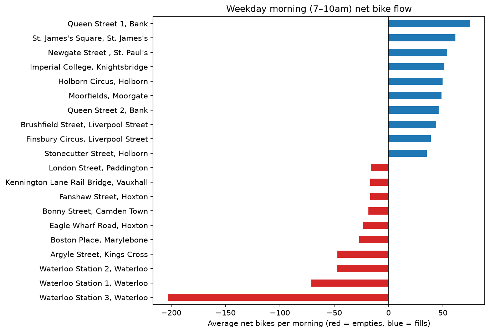
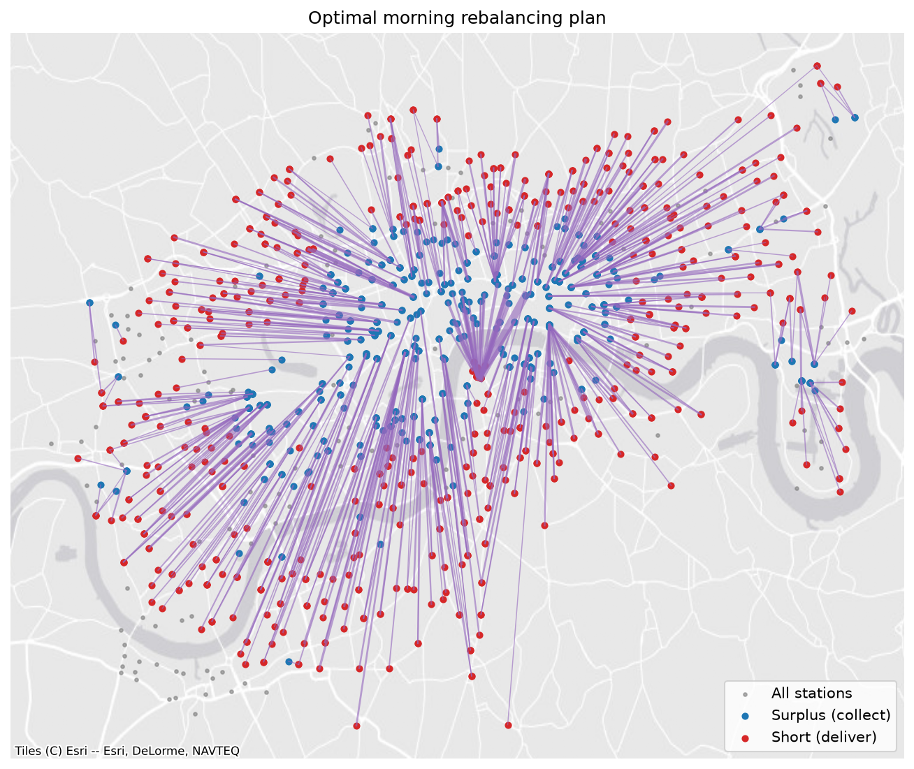

# London Bike-Share Optimisation

A side project I built to learn SQL properly, using TfL Santander Cycles journey data from 1–15 January 2026.

I loaded about 235k journeys into PostgreSQL, cleaned them, and looked at which docking stations empty or fill during the working-day morning rush (7–10am, excluding the 1–2 January holidays). Waterloo empties by up to ~200 bikes a morning as commuters come off the trains and ride on, while the City and Holborn fill up.



I then set up rebalancing (moving bikes from full stations to empty ones) as a transportation problem in PuLP. The optimal plan moves 2,916 bikes using 5,943 bike-km, compared with 7,115 for a greedy nearest-station approach, so about 16.5% less.



I also forecast hourly demand with ridge regression. On a time-based train/test split it gets a mean absolute error of 141 journeys/hour, against 196 for just using the same hour last week.

The cleaning logic is in `sql/`, the Python in `src/`, and the analysis and plots in `notebooks/analysis.ipynb`. Seven stations from January are not in TfL's current location feed, so they are left out of the rebalancing.

To run it, put the TfL journey CSVs in `data/raw/`, set `BIKESHARE_DB_URL` in a `.env` file to point at a PostgreSQL database, then:

```
pip install -r requirements.txt
python src/run_pipeline.py
```

Distances are straight-line rather than road distances, and two weeks of January data is a small sample. In the future, I would like to add more months, weather data and per-station forecasts.
